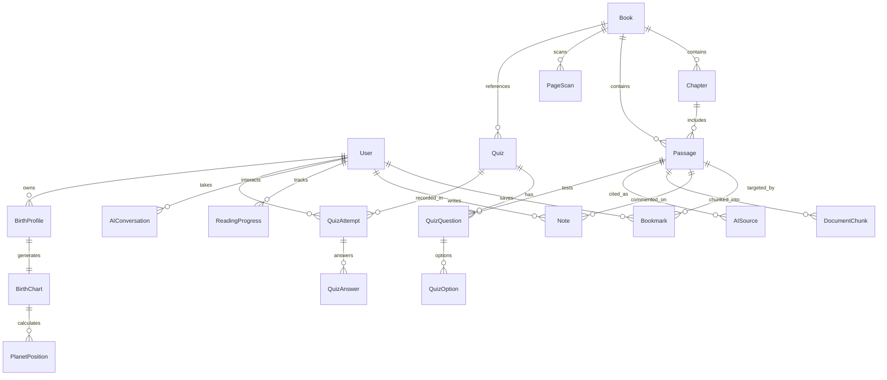

# Gurukul Astrology — System Architecture

## 1. Overview
**Gurukul Astrology** is a scalable digital knowledge and learning platform dedicated to classical Vedic astrology (Jyotish Shastra). The system is built with Next.js (App Router, JavaScript), Tailwind CSS, PostgreSQL, and Prisma ORM.

The platform is designed around 9 future pillars:
1. Digital Astrology Books / E-Books
2. PDF-to-eBook OCR Conversion Pipeline
3. Full-Text & Fuzzy Astrological Search
4. Grounded AI Integration (RAG)
5. AI Chat & Manuscript Querying
6. Vedic Kundli, Natal Chart & Planetary Ephemeris Engine
7. Scriptural Quizzes & Interactive Learning
8. User Bookmarks, Annotations & Reading Progress Tracking
9. Editorial & Admin Portal

---

## 2. Directory Structure

```text
app/
├── (public)/
│   ├── page.js                     # Public home page
│   ├── library/
│   │   ├── page.js                 # Catalog of published books
│   │   └── [book]/
│   │       ├── page.js             # Book TOC, metadata & start reading
│   │       └── [chapter]/
│   │           └── page.js         # Chapter reader & passage renderer
│   ├── astrology/
│   │   └── page.js                 # Astrology & Kundli portal
│   ├── search/
│   │   └── page.js                 # Classical text & verse search
│   ├── ai/
│   │   └── chat/
│   │       └── page.js             # Ask Gurukul AI chat UI
│   └── quiz/
│       └── page.js                 # Public quiz catalog & test viewer
│
├── dashboard/
│   ├── page.js                     # Reader dashboard & progress overview
│   ├── bookmarks/
│   │   └── page.js                 # User saved passages
│   ├── notes/
│   │   └── page.js                 # User study annotations
│   └── progress/
│       └── page.js                 # Detailed reading progression
│
├── admin/
│   ├── page.js                     # Admin dashboard metrics
│   ├── books/
│   │   └── page.js                 # Book management table
│   ├── quizzes/
│   │   └── page.js                 # Quiz creator & publisher
│   ├── users/
│   │   └── page.js                 # User roles & permissions management
│   └── audit/
│       └── page.js                 # Audit logs & OCR processing pipeline
│
├── api/
│   ├── books/
│   │   └── route.js                # GET published books / POST book metadata
│   ├── search/
│   │   └── route.js                # GET search queries across scriptures
│   ├── health/
│   │   └── route.js                # System & PostgreSQL live connection probe
│   └── user/
│       └── route.js                # User profile, reading metrics & bookmarks
│
├── globals.css                     # Tailwind CSS design styles
└── layout.js                       # Root layout (Navbar, Footer, HTML shell)

components/
├── layout/
│   ├── Navbar.jsx                  # Top navigation with responsive links
│   └── Footer.jsx                  # Platform footer and Vedic branding
├── ui/                             # Reusable buttons, badges, inputs
├── reader/                         # Passage and chapter reader modules
├── astrology/                      # Natal chart visualizers (Phase 2)
├── search/                         # Filter & search result widgets
├── ai/                             # Chat message bubbles & citation pins
├── quiz/                           # Question options & scoring widgets
├── dashboard/                      # Reading progress meters & note cards
└── admin/                          # Table grids & workflow buttons

lib/
├── prisma.js                       # Singleton Prisma client instance
├── auth.js                         # NextAuth / Auth.js configuration
├── permissions.js                  # Role checks (Admin, Editor, Proofreader)
├── validation.js                   # Zod schemas (Books, Search, Quizzes)
├── search.js                       # Search layer abstraction
└── utils.js                        # Helper utilities (cn, slugify, formatDate)

prisma/
├── schema.prisma                   # Canonical Prisma data model
└── migrations/                     # Executed SQL migrations

scripts/
└── seed.js                         # Database seed script for development

docs/
└── architecture.md                 # Architecture documentation
```

---

## 3. Database Architecture

The PostgreSQL schema is managed via Prisma ORM:



### Core Entity Responsibilities:
- **`Book`**: Represents a canonical treatise (e.g. Brihat Parashara Hora Shastra, Phaladeepika). Tracks status (`RECEIVED`, `PROCESSING`, `PROOFREAD`, `APPROVED`, `PUBLISHED`, `UNPUBLISHED`).
- **`Chapter` & `Passage`**: Granular breakdown of sacred text enabling passage-level bookmarking, citation in AI RAG responses, and quiz generation.
- **`PageScan`**: Retains original OCR image references and raw OCR confidence scores.
- **`DocumentChunk` & `AISource`**: Prepared data structures for passage chunking and citation tracking.
- **`BirthProfile`, `BirthChart`, `PlanetPosition`**: Prepared data structures for Vedic birth charts.

---

## 4. Authentication & Authorization

### Roles
- `USER`: Regular student/reader (can bookmark, take quizzes, take notes, chat with AI).
- `PROOFREADER`: Can review raw OCR transcriptions against source scans.
- `EXPERT`: Astrological validator for commentary and calculations.
- `EDITOR`: Can publish books, edit chapters, and formulate quizzes.
- `ADMIN`: Full system superuser.

### Permission Checks (`lib/permissions.js`)
Permission checks are enforced on server endpoints and Server Actions before database mutation, not solely via client-side routing.

---

## 5. Future Implementation Roadmap

### 5.1 Future AI & RAG Architecture
- **Chunking Pipeline**: Passages are chunked via `DocumentChunk` records.
- **Vector Embeddings**: PostgreSQL with `pgvector` will be configured. Embeddings generated using Gemini / OpenAI text embeddings.
- **Hybrid Retrieval**: Combine PostgreSQL full-text search (`tsvector` / `pg_trgm`) with semantic vector search.
- **Grounded Responses**: AI generates answers citing specific `Passage` IDs stored in `AISource`.

### 5.2 Future Astrology Engine
- **Ephemeris Integration**: Compute exact planetary coordinates using Swiss Ephemeris (`swisseph` node binding or API).
- **Ayanamsa Support**: Lahiri (Chitrapaksha), Raman, KP, and Tropical ayanamsas.
- **Divisional Charts**: D1 (Rashi), D9 (Navamsha), D10 (Dashamsha), up to D60 (Shashtiamsha).
- **Vimshottari Dasha Engine**: Compute Mahadasha, Antardasha, and Pratyantardasha balance at birth from Moon Nakshatra.

### 5.3 Future PDF-to-eBook OCR Pipeline
- **Upload**: PDF uploaded to S3 / Cloud Storage.
- **Page Extraction**: Split into high-res images (`PageScan` records).
- **OCR Engine**: Tesseract / Google Cloud Vision OCR specializing in Devanagari Sanskrit / Hindi.
- **Editorial Review**: Proofreaders compare `PageScan.imageKey` side-by-side with `PageScan.rawText`.
- **Passage Segmentation**: Approved pages are structured into `Chapter` and `Passage` records.
